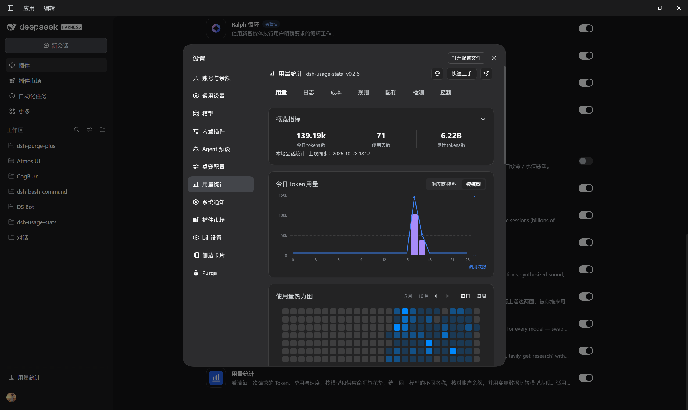
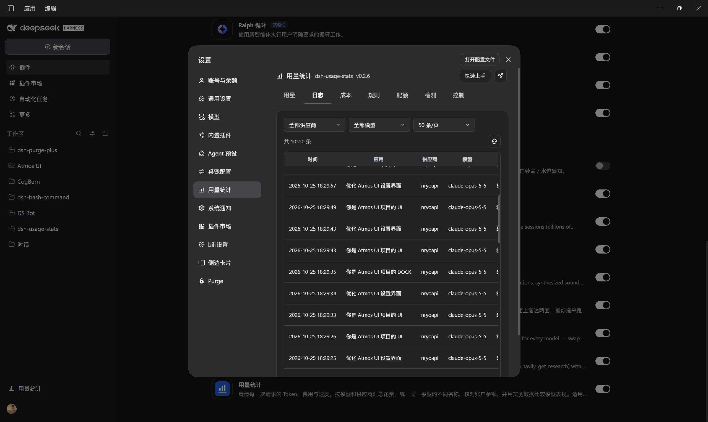
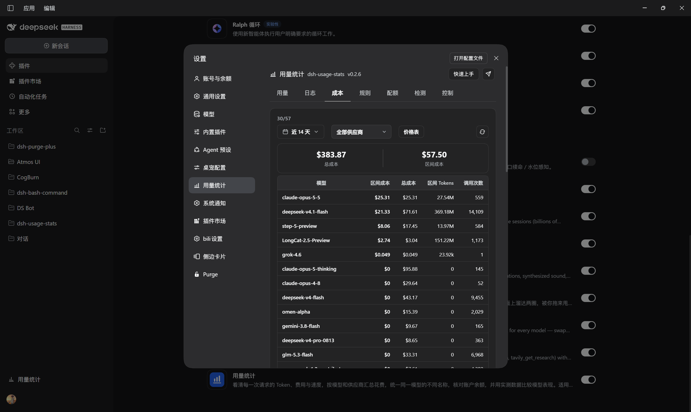
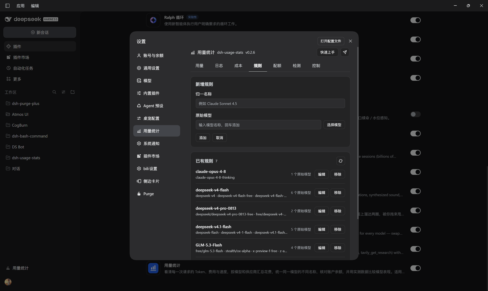
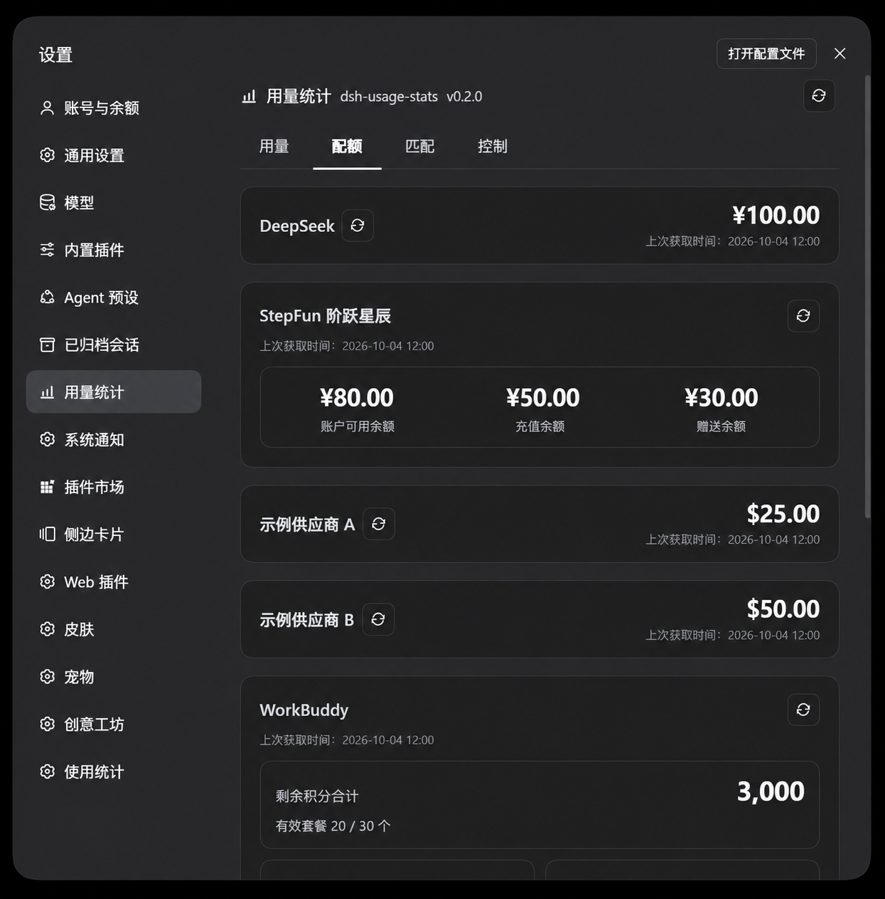
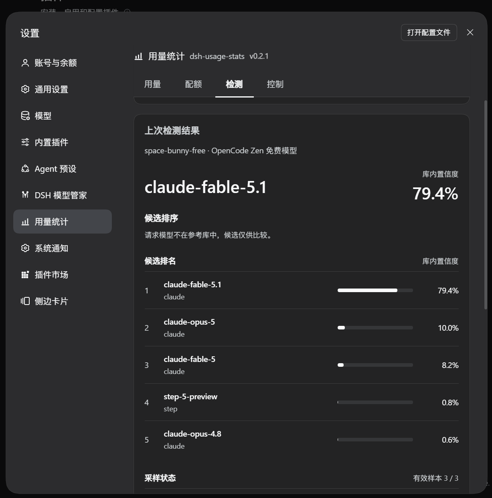
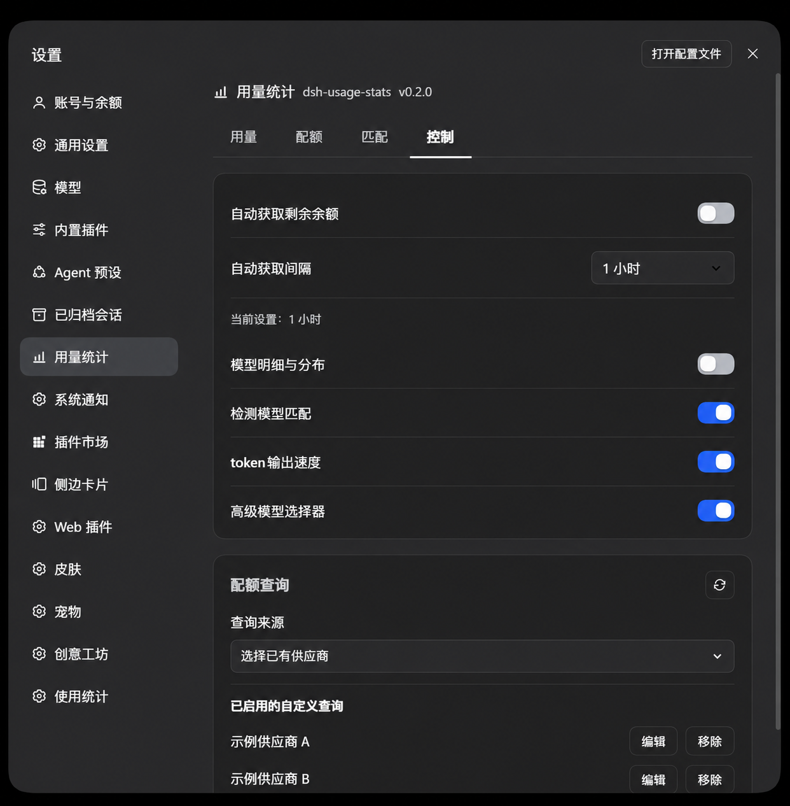
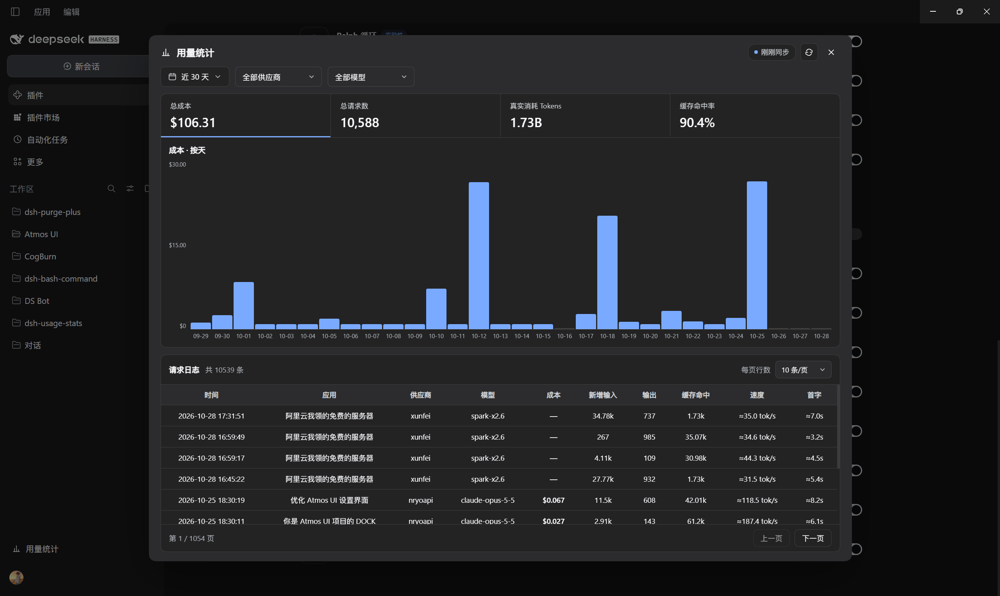

<p align="center">
  
</p>

<h1 align="center">dsh-usage-stats</h1>

<p align="center">
  <strong>See your token usage, balances, and provider quotas inside DSH.</strong><br>
  A local usage dashboard for <a href="https://github.com/deepseek-ai/deepseek-harness">DeepSeek Harness Desktop</a>.
</p>

<p align="center">
  <a href="#installation"></a>
  <a href="https://github.com/Jockjrop/dsh-usage-stats/releases/latest"></a>
  <a href="LICENSE"></a>
</p>

<p align="center">
  <a href="README.md">简体中文</a><br>
  <a href="https://github.com/Jockjrop/dsh-usage-stats/releases/latest">Download</a> ·
  <a href="#features">Features</a> ·
  <a href="#installation">Installation</a> ·
  <a href="#usage">Usage</a> ·
  <a href="#faq">FAQ</a> ·
  <a href="CHANGELOG.md">Changelog</a> ·
  <a href="https://github.com/Jockjrop/dsh-usage-stats/issues">Feedback</a>
</p>

<p align="center">
  <a href="screenshots/usage.png"></a>
</p>

<p align="center"><sub>See today's and lifetime usage, hourly trends, the heatmap and model output speed.</sub></p>

<table align="center">
  <tbody>
    <tr>
      <td align="center"><a href="screenshots/logs.png"></a><br><sub>Check the tokens, cost and speed of every request.</sub></td>
      <td align="center"><a href="screenshots/costs.png"></a><br><sub>Review spending by model and price unpriced models.</sub></td>
    </tr>
    <tr>
      <td align="center"><a href="screenshots/rules.png"></a><br><sub>Merge different names of the same model into one total.</sub></td>
      <td align="center"><a href="screenshots/quotas.png"></a><br><sub>Check provider balances, account credits and quota windows.</sub></td>
    </tr>
    <tr>
      <td align="center"><a href="screenshots/detection.png"></a><br><sub>Confirm a budget, then review candidate rankings and incurred usage.</sub></td>
      <td align="center"><a href="screenshots/controls.png"></a><br><sub>Toggle modules and adjust model, accent and refresh settings.</sub></td>
    </tr>
  </tbody>
</table>

<p align="center">
  <a href="screenshots/dashboard.png"></a>
</p>

<p align="center"><sub>Open the dashboard from the sidebar for range cost, trends and the latest requests.</sub></p>

## Features

| Tab | What you can do |
| --- | --- |
| **Usage** | View today's and lifetime tokens, active days, hourly calls, daily/weekly heatmaps, trends, model breakdowns and output speed. |
| **Logs** | Review every request's app, provider, model, cost, tokens and speed over time, with filters and paging. |
| **Costs** | Convert tokens into money with the price table, review total and range cost, range tokens and per-model spending, and maintain custom rates. |
| **Rules** | Merge different raw names of the same model into one name so usage, logs and costs are counted together. |
| **Quotas** | Check provider balances, account credits and quota windows, with manual or scheduled refresh and custom queries. |
| **Detection** | Select a provider and model independently, confirm a budget, then run LM Fingerprint sampling and review request progress, sample status, candidate rankings and saved results. |
| **Controls** | Adjust display preferences, quota query settings, the advanced model selector and per-model reasoning levels. |

- **Follow usage trends:** browse daily/weekly heatmaps, switch between 7/30-day trends and compare providers and models.
- **Sidebar dashboard:** open Usage Stats from the sidebar to switch between cost, requests, real tokens and cache hit rate, view hourly, daily, monthly or 53-week heatmap charts, and inspect the built-in request log with filters and paging.
- **Quick start and feedback:** the Quick start button explains every tab in place, the send icon opens GitHub Issues, and the top of Controls links to the repository to leave a star.
- **Compare output speed:** rank models by TPS and show average time to first token (TTFT); samples without valid timing are excluded from speed rankings.
- **Refresh quotas on demand:** use DSH credentials for configured providers. Account quotas require the corresponding plugin or host service. Automatic refresh is off by default.
- **Consistent number units:** large values use `k` / `M` / `B` across Chinese, English and Japanese.
- **Run independent detection:** follow model selection, budget confirmation and results. Use three samples by default or one for screening, with progress, cancellation, timeouts and usage budgets.
- **Adjust model settings:** control the advanced model selector and reasoning features independently while retaining model properties, parameter mappings and saved preferences.
- **Follow the application language:** Chinese, English and Japanese UI text follows DSH's selected language; custom names and quota labels remain unchanged.

Detection compares random-number samples with a reference library. Rankings and library confidence measure similarity to known candidates; they do not prove model identity or capability. Reading catalogs, budgets or saved results does not start inference.

## Installation

Plugin version **0.2.7** supports **DSH Desktop `0.2.1-rc.3`** with the compatibility range `>=0.2.1-rc.1 <=0.2.1-rc.3` (0.2.1-rc.1, 0.2.1-rc.2 and 0.2.1-rc.3). The host plugin manager rejects installation or activation on a mismatched runtime.

**Recommended: install the [npm package `@sligqoer/dsh-usage-stats`](https://www.npmjs.com/package/@sligqoer/dsh-usage-stats) through DSH Desktop.** It includes prebuilt modules, needs no Git checkout or local build, and supports Check updates when installed by package name.

### 1. Open the plugin installer

In DSH Desktop's main sidebar, open **Plugins → Add plugin**.

### 2. Enter the full npm package name

```text
@sligqoer/dsh-usage-stats
```

Paste it into **Package name or address**, click **Install**, and keep the full `@sligqoer/` scope.

### 3. Enable and open

Click **Enable now**, then open **Settings → Usage Stats**. Fully exit and reopen DSH Desktop when the plugin manager requests a restart.

<details>
<summary>Install a specific version or a downloaded archive</summary>

Enter this in the same installer for this release:

```text
@sligqoer/dsh-usage-stats@0.2.6
```

Alternatively, download a `.tgz` and `SHA256SUMS` from the [GitHub release page](https://github.com/Jockjrop/dsh-usage-stats/releases/latest), verify the hash and enter the archive's local absolute path. Do not extract it before installation.

```powershell
Get-FileHash ./sligqoer-dsh-usage-stats-0.2.6.tgz -Algorithm SHA256
```

Assets include `sligqoer-dsh-usage-stats-0.2.6.tgz`, the equivalent `dsh-usage-stats.tgz`, and `SHA256SUMS`. Both archives contain identical modules.

</details>

<details>
<summary>Updates and migration</summary>

Use **Check updates** for installations made by npm package name. Installations from GitHub URLs, archives or local paths require a new manual installation.

If you use the old `dsh-usage-stats` package name, uninstall it once and install `@sligqoer/dsh-usage-stats`. Saved settings and usage remain available. See [CHANGELOG.md](CHANGELOG.md) for upgrade changes.

</details>

## Usage

1. Open Usage for the overview, trends, heatmaps and output speed; the sidebar Usage Stats entry opens the dashboard directly.
2. Use Logs to filter requests by provider and model, Costs to pick a date range and maintain the price table, and Rules to merge different names of the same model.
3. Refresh provider or account cards in Quotas. Automatic refresh is off by default; enable it in Controls after confirming the notice.
4. Select a provider and model in Detection, set sample counts and output limits, click **Preview detection budget**, then confirm with **Start detection (uses tokens)**. Reading catalogs or saved results never starts detection.
5. Use Controls to toggle the advanced model selector, reasoning features and detection independently, or edit custom quota queries. The Quick start button in the top-right explains each tab.

Detection guides you through choosing a model, confirming the budget and reviewing results. Changing the model or parameters requires a new budget preview. While a test runs, you can follow request progress and sample status or cancel it. Saved results retain their original model and parameters; detection details and engine information expand on demand.

## Data and compatibility

Local data is stored under `DSH_HOME/storages`:

| File or directory | Contents |
| --- | --- |
| `usage-stats-corpus.json` | Session usage aggregates. |
| `usage-stats-display.json` | Usage display preferences. |
| `usage-stats-quota-controls.json` | Query and model settings plus provider quota caches. |
| `usage-stats-prices.json` | Custom model prices in USD per million tokens. |
| `usage-stats-rules.json` | Model-name merge rules. |
| `usage-stats-detections.json` | Detection results and reported sample usage. |
| `usage-stats-lm-fingerprint/` | Verified engine and reference updates. |
| `usage-stats-supplemental.json` | Detection usage deduplicated by task and sample ID and retained across restarts. |

Conversation tokens come from DSH session logs. Detection usage is deduplicated by task and sample ID before aggregation. Request diagnostics are excluded from token totals. Updates retain saved configuration and usage history. On platforms that support it, these files are written owner-only.

After upgrading from 0.2.0, detection uses LM Fingerprint. The earlier behavioral references, KBF import/export and capability baseline tests are no longer provided; previously incurred detection usage remains available. Release packages exclude personal sessions, account credentials, quota caches and detection history; local caches are written with owner-only permissions.

## FAQ

**Does it work in DSH Web?**

This version supports only DSH Desktop's desktop profile.

**Why is a quota card missing or unavailable?**

Check provider configuration, credentials, enabled account plugins and support for the quota API. A model API key may not have billing permissions.

**Are token totals a bill?**

No. Token totals come from local sessions and reported detection usage. Balances and quota windows come from provider APIs.

**Can detection rankings prove model identity?**

No. Rankings measure similarity to the reference library. When the requested model is outside the library, candidates serve only as comparisons.

## API

The `dshUsageStats` host service uses `protocolVersion: 1` and exposes `readStats`, `readControls`, `updateControls`, `readProviderQuotas` and `readSupplementalUsage`.

HTTP routes under `/api/dsh-usage-stats/*` provide statistics, controls, quotas and detection. They require loopback access and trusted origins and disable caching.

## Development

Use Node.js 22 or later (development and CI use 24) and the dependencies pinned in `package-lock.json`:

```sh
npm ci
npm run lint
npm run build
npm test
npm run check:release
npm run release
```

Edit `src/` and run `npm run build` to generate `lib/`. `src/client.js` is the renderer template; the build inlines `client-messages.js`, `client-styles.js`, `client-format.js` and the other modules at their markers, so the shipped artifact is still a single `lib/client.js`. `npm run lint` checks syntax, JSON documents and the three-language table; `npm run check:release` checks versions, generated files, third-party integrity and private workspace files. `npm run release` builds the package and verifies installation and loading in an isolated temporary project; artifacts go to `release/`.

The GitHub workflow requires the tag to match the package version (`v0.2.6` for this release) and publishes the same verified archive to npm and GitHub Releases. The npm trusted publisher workflow file is `.github/workflows/release.yml`. Third-party assets, source revisions and licenses are recorded in `third_party/` and [NOTICE](NOTICE). This project uses the [Apache-2.0 license](LICENSE).
