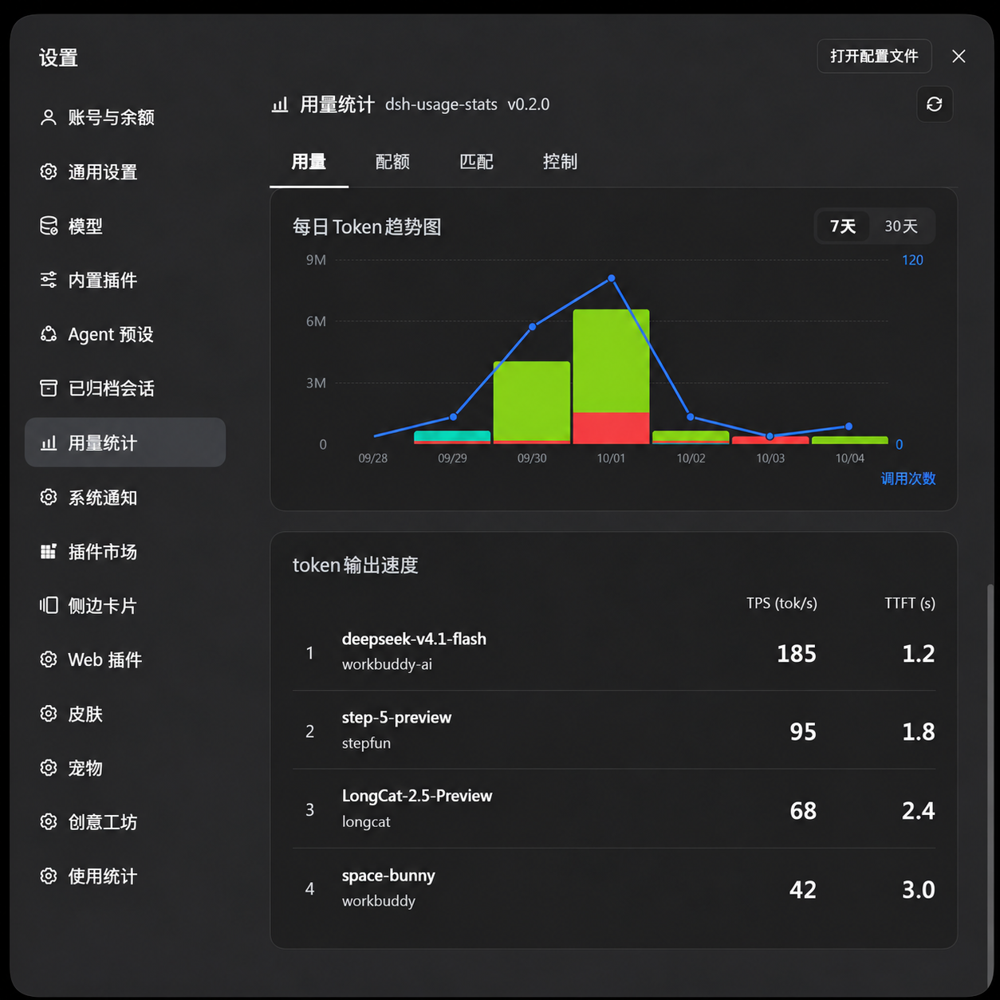
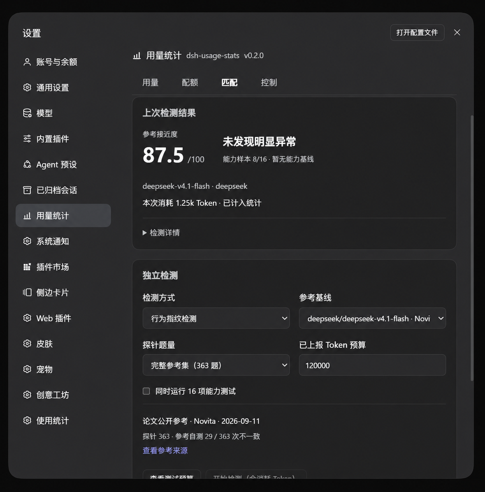

<p align="center">
  
</p>

<h1 align="center">dsh-usage-stats</h1>

<p align="center">
  <strong>See your token usage, balances, and quotas inside DSH.</strong><br>
  A local usage dashboard for <a href="https://github.com/deepseek-ai/deepseek-harness">DeepSeek Harness Desktop</a>.
</p>

<p align="center">
  <a href="#installation"></a>
  <a href="https://github.com/Jockjrop/dsh-usage-stats/releases/latest"></a>
  <a href="LICENSE"></a>
</p>

<p align="center">
  English · <a href="README.zh-CN.md">简体中文</a><br>
  <a href="https://github.com/Jockjrop/dsh-usage-stats/releases/latest">Download</a> ·
  <a href="#features">Features</a> ·
  <a href="#installation">Installation</a> ·
  <a href="#usage">Usage</a> ·
  <a href="#faq">FAQ</a> ·
  <a href="CHANGELOG.md">Changelog</a> ·
  <a href="https://github.com/Jockjrop/dsh-usage-stats/issues">Feedback</a>
</p>

<p align="center">
  <a href="screenshots/usage.png"></a>
</p>

<p align="center"><sub>Today's usage, lifetime totals, and the patterns behind them. Screenshot versions and values have been edited for this release and use synthetic data.</sub></p>

<table align="center">
  <thead>
    <tr><th align="center">Quotas · 配额</th><th align="center">Controls · 控制</th></tr>
  </thead>
  <tbody>
    <tr>
      <td align="center"><a href="screenshots/quotas.png"></a></td>
      <td align="center"><a href="screenshots/controls.png"></a></td>
    </tr>
    <tr>
      <td align="center">Check provider balances and WorkBuddy credits in one place.</td>
      <td align="center">Set automatic refresh intervals and custom quota queries.</td>
    </tr>
  </tbody>
</table>

<table align="center">
  <thead>
    <tr><th align="center">Token output speed · token输出速度</th><th align="center">Model match · 模型匹配</th></tr>
  </thead>
  <tbody>
    <tr>
      <td align="center"><a href="screenshots/token-speed.png"></a></td>
      <td align="center"><a href="screenshots/match.png"></a></td>
    </tr>
    <tr>
      <td align="center">Compare output speed and first-token wait across providers.</td>
      <td align="center">Review the score, verdict and counted audit usage.</td>
    </tr>
  </tbody>
</table>

## Features

| Tab | What you can do |
| --- | --- |
| **Usage · 用量** | View today's and lifetime tokens, active days, hourly calls, a daily/weekly heatmap, model breakdowns, and token output speed. |
| **Quotas · 配额** | Check configured account balances, subscription windows, and optional WorkBuddy / WorkBuddy AI credits. |
| **Match · 匹配** | Enable Detect model match in Controls to show this tab (off by default). Analyze the current session's request settings and response-declared model; optionally run cancellable independent tests. |
| **Controls · 控制** | Choose a refresh interval, configure custom quota queries, and toggle model details, model matching, token output speed, or the advanced model selector. |

- **Follow your usage:** switch the trend between 7 and 30 days, page through daily or weekly history, and compare providers and models.
- **Keep quotas together:** use built-in readers or map a custom provider's JSON response.
- **Refresh on your terms:** fetch manually or enable scheduled queries. Automatic quota refresh is off by default.
- **Inspect overview metrics:** expand the overview for cache hit rate, historical daily token peak, longest completed user round, current and longest usage streaks, and the most-called model in the last seven days. Same model names merge across providers. Round timing requires complete start/end records and excludes idle gaps between messages; today's streak continues through yesterday until a full unused day. Retained historical totals stay included.
- **Compare output speed:** Token output speed is on by default, sorting provider/model pairs by DSH TPS: cumulative output tokens divided by cumulative first-nonempty-output-to-response-completion time, in tok/s. TTFT shows the average time from call start to first non-empty token for completed timed calls, in seconds; missing records show a dash. Samples without valid decode timing are excluded from the ranking. Hide it in Controls.
- **Keep successful results:** failed quota refreshes retain amounts and timestamps with safe diagnostics. Card refreshes query only their provider; query drafts survive tab changes.
- **Choose models faster:** opt into a model/reasoning panel with an effort slider; disabling it restores the official selector.
- **Fit the desktop:** light/dark themes, responsive charts, pinned tabs, and a keyboard-operable provider picker.
- **Follow your language:** Chinese, English, and Japanese UI text updates with DSH's selected language. User-defined names and quota labels stay as configured.

## Installation

**Recommended: install the [npm package `@sligqoer/dsh-usage-stats`](https://www.npmjs.com/package/@sligqoer/dsh-usage-stats) through DSH Desktop.** It includes prebuilt modules, needs no Git checkout or local build, and supports the plugin page's Check updates button when installed by package name.

### 1. Open the plugin installer

In DSH Desktop's main sidebar, open **插件 → 添加插件** (Plugins → Add plugin).

### 2. Enter the full npm package name

```text
@sligqoer/dsh-usage-stats
```

Paste it into **包名或地址** (Package name or address) and click **安装** (Install). Keep the full `@sligqoer/` scope.

### 3. Enable and open

Click **立即启用** (Enable now), then open **Settings → 用量统计**. Restart DSH if its plugin manager asks you to.

Usage statistics load from your local DSH sessions. Open **配额** and click a refresh button to query an account.

<details>
<summary>Install a specific version or a downloaded archive</summary>

To install version `0.2.0`, enter this in the same installer:

```text
@sligqoer/dsh-usage-stats@0.2.0
```

You can also manually install a [Release archive](https://github.com/Jockjrop/dsh-usage-stats/releases/latest). Enter the URL below, or download the `.tgz` and `SHA256SUMS`, verify the hash, and enter the archive's local absolute path. Do not extract it before installing.

```text
https://github.com/Jockjrop/dsh-usage-stats/releases/latest/download/dsh-usage-stats.tgz
```

```powershell
Get-FileHash ./sligqoer-dsh-usage-stats-0.2.0.tgz -Algorithm SHA256
```

</details>

<details>
<summary>Install from source / manually link a checkout</summary>

For development, install Git, Node.js and pnpm, then build the checkout. This path is verified on Windows with Node.js 24:

```sh
git clone https://github.com/Jockjrop/dsh-usage-stats.git
cd dsh-usage-stats
npm ci
npm run build
```

Keep the clone in a permanent location; DSH will link to it.

In **插件 → 添加插件**, enter the clone's absolute path, install it, and click **立即启用**. To link it manually instead, fully exit DSH Desktop and back up its profile's `package.json`, then run this in **PowerShell from the cloned directory**:

```powershell
$pluginDir = (Get-Location).Path.Replace('\', '/')
$dshDataDir = if ($env:DSH_HOME) { $env:DSH_HOME } else { Join-Path $env:USERPROFILE '.dsh' }
$profileDir = Join-Path $dshDataDir 'profiles/desktop'
pnpm --dir $profileDir add "link:$pluginDir"
```

Open `$profileDir/package.json` and append `"@sligqoer/dsh-usage-stats"` to its existing `dsh.profile.bundles` array. Keep the other bundle entries.

DSH Desktop manages its own profile; `dsh plugin --profile desktop` is unavailable. After a manual link, start the app and open **Settings → 用量统计**.

</details>

<details>
<summary>Updating or uninstalling</summary>

**Migrating an older installation:** uninstall the old `dsh-usage-stats` package from the Plugins page, then install and enable `@sligqoer/dsh-usage-stats` by name. This package-name migration is needed only once; the plugin keeps its existing data directory, quota routes, and settings identifiers.

**npm installation:** use Check updates on the plugin page and restart if prompted. The current update checker only handles direct npm package-name installations. GitHub URLs, archive URLs, local paths, and `link:` installations need manual updates; “Already up to date” for these sources does not confirm that no newer release exists.

**Release installation:** uninstall the package from the Plugins page, install the Release URL above again, and enable it. To uninstall permanently, use the same page's uninstall action.

**Source installation:** fully exit DSH Desktop, run these commands in the clone, and restart:

```sh
git pull --ff-only
npm ci
npm run build
```

**Manual link removal:** exit DSH Desktop, remove only the `@sligqoer/dsh-usage-stats` dependency and bundle entry from its profile, run `pnpm install` there, and restart.

</details>

## Usage

**用量** shows how much you use and when. Hover a chart or heatmap cell for its breakdown. The overview cards retain their today/lifetime meanings when you change a historical filter.

**配额** shows data returned by connected platforms. Configured balances may show **未查询** until their first query; available cards depend on credentials and account permissions.

**控制** lets you change display and refresh settings:

| Setting | Default |
| --- | --- |
| Automatic quota refresh | Off |
| Refresh interval | 1 hour; also supports 10 minutes, 5 hours, or daily |
| Model details | On |
| Detect model match | Off |
| Token output speed | On |
| Advanced model selector | Off |

Enabling automatic queries asks you to acknowledge possible query costs. The schedule continues while the settings page is closed. Opening the quota page normally reads cached results.

<details>
<summary><strong>Supported providers and credentials</strong></summary>

Built-in readers cover Claude, DeepSeek, StepFun, Codex, GitHub Copilot, OpenRouter, Moonshot China/global, Kimi Coding, MiniMax China/global, Z.AI, GLM Coding, Alibaba Cloud Token Plan China, xAI, and OpenCode Go.

The corresponding provider must be configured in DSH. Supported OAuth readers use existing unexpired grants; this plugin does not refresh or modify logins.

| Optional reader | Host credential references |
| --- | --- |
| OpenRouter account credits | `OPENROUTER_MANAGEMENT_API_KEY` |
| xAI prepaid balance | `XAI_MANAGEMENT_API_KEY`, `XAI_TEAM_ID` |
| Alibaba Cloud Token Plan China | `ALIBABA_CLOUD_ACCESS_KEY_ID`, `ALIBABA_CLOUD_ACCESS_KEY_SECRET`; optional `ALIBABA_CLOUD_SECURITY_TOKEN` |

OpenCode Go uses only its own configured DSH credential. Zen has no built-in wallet balance reader, but supports custom queries. Alibaba Cloud's international Token Plan is not queried.

WorkBuddy and WorkBuddy AI require the optional `dsh-workbuddy-connect` adapter. Their quotas are cached and refreshed separately.

</details>

<details>
<summary><strong>Set up a custom quota query</strong></summary>

1. Open **控制 → 配额查询** and select an existing provider.
2. Enter the query URL and response mapping.
3. Click **测试** and check the parsed result.
4. Confirm the query to show it in **配额**.

For an endpoint returning `{ "data": { "balance": 12.34 } }`:

```json
{
  "url": "https://api.example.com/balance",
  "method": "GET",
  "auth": "provider",
  "headers": { "accept": "application/json" },
  "response": {
    "metrics": [
      {
        "label": "Account balance",
        "kind": "amount",
        "remaining": "data.balance",
        "currency": "USD"
      }
    ]
  }
}
```

Replace the example URL with the provider's working endpoint. `auth: "provider"` uses its configured DSH credential; authenticated URLs must share the configured or official quota origin.

Templates support GET/POST, JSON bodies, amount/window metrics, and paths such as `data.items[0].balance`. Window metrics accept percentage fields or `total` with `remaining`/`used`; `response.rows` selects an array. Use `auth: "none"` for unauthenticated endpoints.

Editing invalidates the test; successful tests expire after 15 minutes. A confirmed query overrides the built-in reader for that provider. Removing it restores the built-in reader.

</details>

## Privacy

Usage aggregation runs locally. The plugin saves counts, model identifiers, usage timestamps, explicit session titles and working directories, and at most 30 bounded model-evidence records per session. It does not keep conversation bodies, private replay blocks or credentials. Credentials are resolved on the host and are not returned to the renderer. Independent tests persist reported usage and the most recent 10 results without prompts or raw responses.

The Match tab follows the current session. Metadata declarations provide weak hints only. Reading logs, references and budget previews makes no inference calls.

Behavioral auditing uses [KBF](https://github.com/Ooo0ption/KBF)-compatible knowledge-boundary fingerprints, including consistent wrong answers. The package includes 28 references and 10,327 probes with dates, deployment provenance and original-file SHA-256 hashes. Some references use third-party deployments; DeepSeek V4.1 Flash uses Novita. Import KBF JSON or create a reference through a trusted configured provider for additional models. Custom calibration filters three consensus passes and performs an independent self-test on the retained set. It does not reproduce the paper's full contrast-model screening experiment.

Use the reference's CP99 upper error bound and a one-sided binomial test (p < 0.05), with at least 64 valid answers and 80% coverage on both sides. Recalibration is required when the reference's noise bound exceeds 30%. Results indicate significant difference, no significant difference, or insufficient evidence. A p-value is not the probability of model authenticity. Public references use temperature zero and suppressed reasoning; unsupported models need references calibrated with matching parameters. Behavioral changes may reflect versions, prompts or deployment configuration.

Completed behavioral audits show a 0–100 reference similarity score: matching answers divided by valid answers, multiplied by 100. This is answer agreement, not an authenticity probability. Cancelled, interrupted or insufficient-evidence audits remain unscored. Saved results receive scores without another test. Audit details starts collapsed and contains the parameters, validation process, statistical test and channel measurements.

Sixteen seeded capability tasks cover code tracing, path reasoning, context retrieval and constraint optimization. Custom references can retain their scores for paired decline tests under matching reasoning settings. Without a capability reference, results describe this run only. TPS/TTFT remain performance measurements.

Select **Preview test budget** to inspect the actual parameters, call limit, input estimate, output cap and reported-token budget, then **Start audit (uses tokens)**. Quotes expire after five minutes and are single-use. Runs are cancellable with a 60-second per-call timeout; reported-token budgets stop subsequent calls. Reasoning, unreported usage and provider retries follow channel billing, so this is not an absolute invoice cap. Tests do not use conversation content or modify the session; each call's reported usage enters the statistics, including failed or cancelled calls. Store up to 20 private references atomically in `storages/usage-stats-model-baselines.json`; save usage and the last 10 results in `storages/usage-stats-model-tests.json`. A verdict above the form explains behavior, capability decline or an inconclusive result. Host-interrupted tests remain inconclusive. After switching or deleting the original conversation, the previous result stays available and applies only to its listed model and settings.

Quota tests and refreshes contact the selected platform. There is no analytics or telemetry endpoint.

<details>
<summary>Storage and request safeguards</summary>

Local files live under `<DSH_HOME>/storages/`, or the current user's `.dsh/storages/` when `DSH_HOME` is unset:

| File | Contents |
| --- | --- |
| `usage-stats-corpus.json` | Per-session usage contributions |
| `usage-stats-controls.json` | Controls, custom templates and quota snapshots |
| `usage-stats-model-baselines.json` | Private behavioral and capability references |
| `usage-stats-model-tests.json` | Reported audit usage and the last ten results |

These are private local files, excluded from Git along with credentials, environment files, databases, logs, backups and previews.

The API checks loopback addresses, Host, Origin and cross-site requests, sends `Cache-Control: no-store`, and hides unexpected host exception details. Another process under your account can access local data.

Custom queries reject authentication headers and common credential fields in templates, require the appropriate origin for provider authentication, and do not follow redirects. They have an 8-second timeout and a 1 MB response limit. WorkBuddy adapters retain quota display fields only.

</details>

## FAQ

**Does it work in DSH Web?**

This version loads only in the desktop profile and Electron main window.

**Why is a quota card missing or unavailable?**

Check that the provider is configured, its credential is usable, and the account supports the quota API. A model API key may not have billing permissions.

**Are displayed token totals a bill?**

No. Usage totals sum input, output, cache-read and cache-write tokens. Account balances come from platform APIs.

**Will it change DSH's files?**

It registers an external bundle. The optional model selector takes over a UI slot while enabled; disabling it restores the official selector without changing DSH source files.

## Contributing

Bug reports and pull requests are welcome. For a bug, include your DSH version, plugin version, steps to reproduce, and a screenshot with private account details removed.

<details>
<summary><strong>Development and local API</strong></summary>

Edit module sources in `src/`. `npm run build` synchronizes modules to `lib/` and root compatibility copies and injects the renderer package identity and header version from `package.json`; package exports load `lib/`.

```sh
npm run build
npm test
node scripts/render-heatmap-check.mjs
node scripts/check-heat-tip-placement.mjs
npm run preview:heatmap
npm pack --dry-run
npm run release
```

Tests use synthetic data and temporary DSH homes; no live credentials or paid calls are required. Set `DSH_THEME_CLIENT` to validate an installed theme client instead of the checked-in alias contract. The synthetic preview writes an ignored `preview-heatmap.html`.

`npm run release` builds the package, writes `sligqoer-dsh-usage-stats-<version>.tgz`, the `dsh-usage-stats.tgz` alias and `SHA256SUMS` to the ignored `release/` directory, then verifies installation in a temporary profile. Release notes include the matching version entry from [CHANGELOG.md](CHANGELOG.md).

A matching `v<package.json version>` tag triggers GitHub Actions to run the tests, publish the verified archive as a public npm package through trusted publishing, and attach the same files to a GitHub Release. Trust is bound to the `release.yml` workflow in `Jockjrop/dsh-usage-stats`; no npm token is stored in the repository. `npm run publish:release` publishes the prebuilt archive and skips an existing version only when its integrity matches; different contents fail the release.

Routes use the `/api/dsh-usage-stats/` prefix:

| Route | Method | Purpose |
| --- | --- | --- |
| `stats` | GET | Usage; `days`, `tz`, `model`, optional `fresh=1` |
| `provider-quotas` | GET | Cached quotas; `fresh=1` refreshes |
| `workbuddy`, `workbuddy-ai` | GET | Adapter caches; support `fresh=1` |
| `controls` | GET / POST | Read/update controls; writes require JSON |
| `quota-providers` | GET | Configured providers and credential-free templates |
| `quota-test` | POST | Test a template and return an expiring confirmation ID |
| `model-match` | GET | Existing response hints and the current/previous audit result |
| `model-test` | POST | Preview a budget, start or cancel an audit |
| `model-baselines` | GET / POST | List, import, export or remove behavioral references |

The corpus refreshes every 30 seconds. Requests wait up to 1500 ms and may return `stale: true`/`partial: true`. SQLite fingerprints require `node:sqlite`; otherwise sessions are reread. Timezone changes re-bucket stored events, with possible approximation for old hourly-only history at fractional-hour boundaries.

The `platform: "web"` declaration is DSH Desktop's renderer transport; both halves still require the desktop profile and the renderer's native bridge.

</details>

## License

[Apache-2.0](LICENSE).
